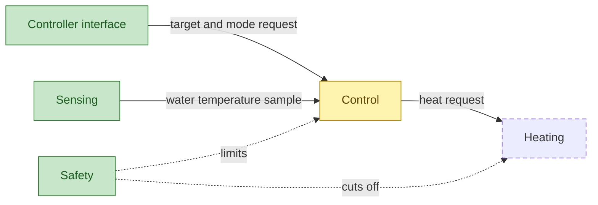
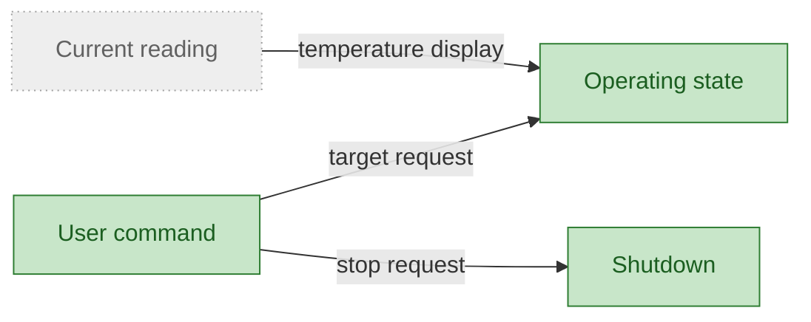
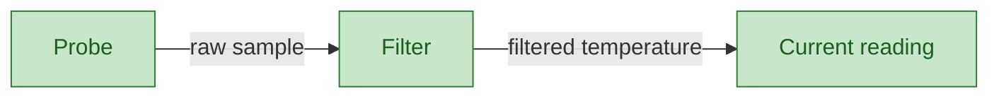
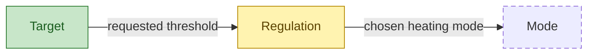
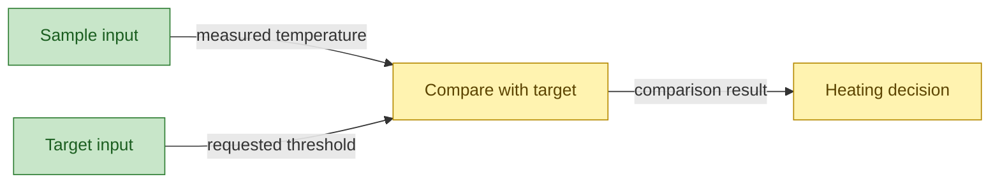
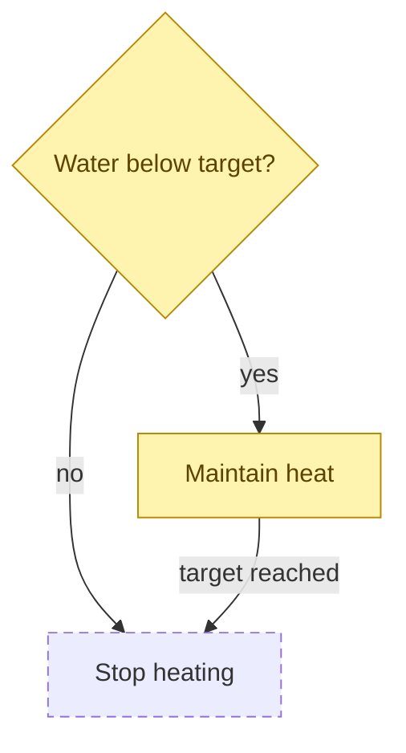
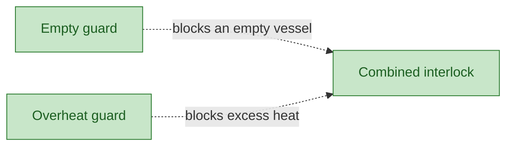
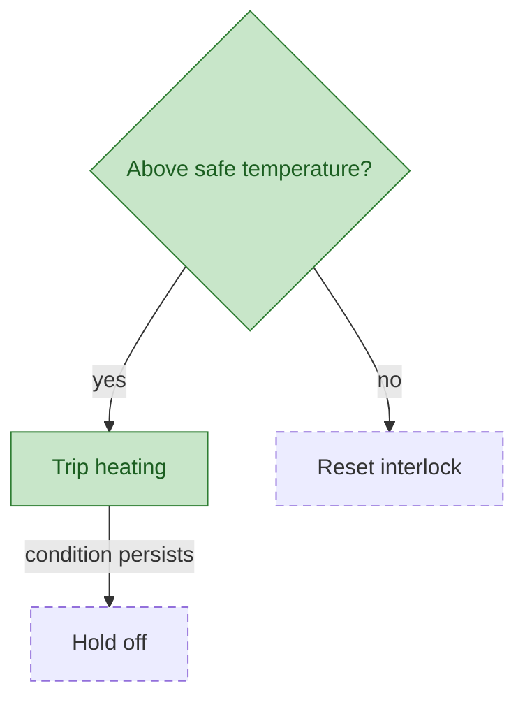

# Concepts

The electric-kettle concept map links to [CODE](CODE.md), [DEFINITIONS](DEFINITIONS.md), [TESTS](TESTS.md), and [SCENARIOS](SCENARIOS.md).

## How to read the diagrams
L1 frames the whole controller; deeper levels open parts or rules that deserve separate decisions. Structure diagrams use solid labelled arrows for what flows and dotted labelled arrows for checks or limits. Rule diagrams are terminal flowcharts: diamonds ask decisions and arrows carry answers. Status colors mean implemented (built), partial (in the current work unit), planned (not started), and external (owned elsewhere). Node IDs are stable references; run `python3 DBC/check_dbc.py` to check this map.

## L1 · Electric kettle controller

| Node | Meaning | Terms | Status |
| --- | --- | --- | --- |
| `ControllerInterface` | Accepts target and mode requests, exposes state, and provides a stop control. | target, mode | implemented |
| `Sensing` | Provides the controller's measured water temperature. | measurement, temperature | implemented |
| `Control` | Chooses whether the element starts, holds, or stops. | control rule, target | partial |
| `Heating` | Transfers energy from the element into the water. | heating element, energy | planned |
| `Safety` | Prevents unsafe heating conditions. | safety, heating element | implemented |

The [Heating subtree](concepts/Heating.md) holds its level-two detail and links back here.

### L2 · Controller interface (`ControllerInterface`)

| Node | Meaning | Terms | Status |
| --- | --- | --- | --- |
| `Command` | Accepts a user request for a temperature. | target, measurement | implemented |
| `State` | Exposes the active operating mode. | mode, state | implemented |
| `Shutdown` | Ends heating when the controller stops. | power, safety | implemented |
| `CurrentReading` | See Temperature sensing. |  | external |

### L2 · Temperature sensing (`Sensing`)

| Node | Meaning | Terms | Status |
| --- | --- | --- | --- |
| `Probe` | Observes the water's current temperature. | measurement, temperature | implemented |
| `Filter` | Provides a stable reading to control. | measurement, temperature | implemented |
| `CurrentReading` | Supplies the value used to choose heating actions. | temperature, measurement | implemented |

### L2 · Temperature control (`Control`)

| Node | Meaning | Terms | Status |
| --- | --- | --- | --- |
| `Regulation` | Coordinates sampling and temperature decisions. | control rule, temperature | partial |
| `Target` | Holds the desired water temperature. | target, temperature | implemented |
| `Mode` | Selects a future controller operating mode. | mode, control rule | planned |

#### L3 · Regulation (`Regulation`)

| Node | Meaning | Terms | Status |
| --- | --- | --- | --- |
| `SampleInput` | Supplies the current temperature to regulation. | measurement, temperature | implemented |
| `TargetInput` | Supplies the requested temperature for comparison. | target, temperature | implemented |
| `CompareTarget` | Compares the sample with the requested temperature. | control rule, target | partial |
| `HeatDecision` | Chooses whether to start, hold, or stop heating. | control rule, heating element | partial |

##### L4 rule · Heating decision (`HeatDecision`)

| Node | Meaning | Terms | Status |
| --- | --- | --- | --- |
| `BelowTarget` | Decides whether the sample is below the requested temperature. | control rule, target | partial |
| `MaintainHeat` | Continues heating while the target is unmet. | control rule, temperature | partial |
| `StopHeating` | Ends heating once the target is reached. | control rule, heating element | planned |

### L2 · Safety interlocks (`Safety`)

| Node | Meaning | Terms | Status |
| --- | --- | --- | --- |
| `EmptyGuard` | Rejects a heating request when the vessel is empty. | safety, heating element | implemented |
| `OverheatGuard` | Stops heating when temperature exceeds the safe range. | safety, temperature | implemented |
| `Interlock` | Allows heating only while safety conditions hold. | safety, control rule | implemented |

#### L3 rule · Overheat response (`OverheatGuard`)

| Node | Meaning | Terms | Status |
| --- | --- | --- | --- |
| `SafeTemperature` | Determines whether water is above the safe temperature limit. | safety, temperature | implemented |
| `Trip` | Stops the element when an overheat threshold is crossed. | safety, heating element | implemented |
| `Hold` | Keeps the element off while the condition persists. | safety, control rule | planned |
| `Reset` | Re-enables control after a safe temperature returns. | safety, temperature | planned |
