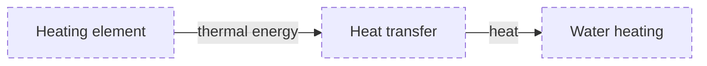

This subtree links back to [CONCEPTS](../CONCEPTS.md).

### L2 · Heating supply (`Heating`)

| Node | Meaning | Terms | Status |
| --- | --- | --- | --- |
| `Element` | The component that transfers energy to water. | heating element, energy | planned |
| `Transfer` | The path by which the element warms water. | energy, temperature | planned |
| `Water` | The water receiving heat from the element. | temperature, energy | planned |
